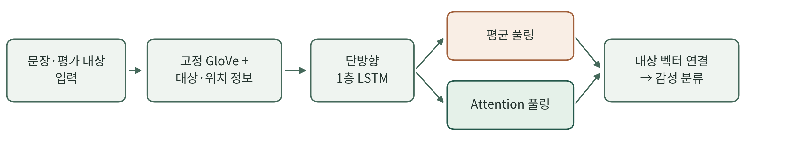
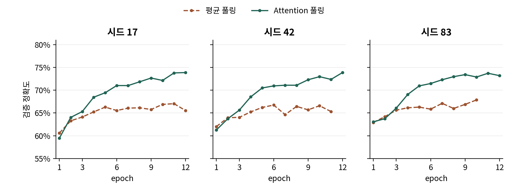
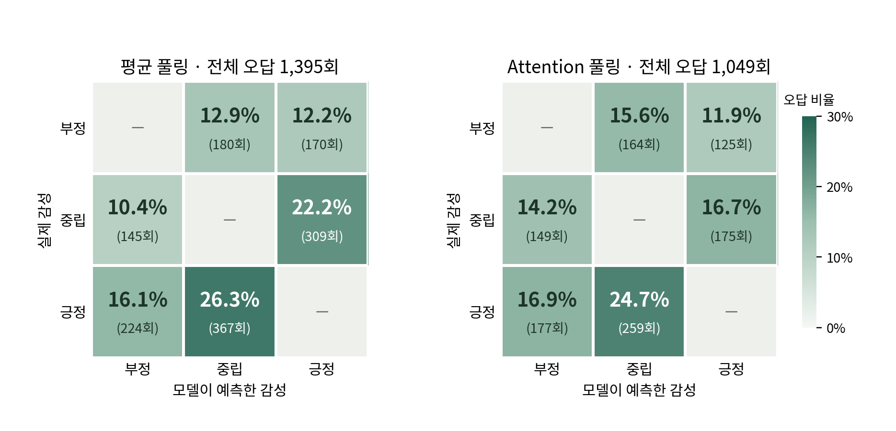

<!-- 1쪽 -->
# MAMS 데이터셋을 활용한 LSTM의 평균 풀링과 Attention 풀링 비교

**대상별 감성 분류 성능과 오답 유형을 중심으로**

작성자 ____________________　학교·학번 ____________________

## 초록

본 연구는 한 문장 속 여러 대상에 대한 평가를 구분하는 감성 분류 과제에서, 문맥 정보를 모으는 방식에 따라 모델의 예측 성능이 달라지는지 살펴보았다. MAMS-ATSA의 영어 식당 리뷰를 이용하여 단방향 LSTM에 평균 풀링을 적용한 모델과, 대상 정보를 이용하는 Attention 풀링을 적용한 모델을 비교하였다. 같은 학습 조건으로 세 가지 난수 시드에서 평가한 결과, 정확도는 평균 풀링 65.19%, Attention 풀링 73.83%였으며, Macro-F1은 각각 0.6341과 0.7232였다. 감성별 F1의 개선 폭은 긍정에서 가장 컸다. 오답 분석에서는 긍정과 중립을 서로 혼동한 횟수가 평균 풀링 676회에서 Attention 풀링 434회로 줄었다. 이 결과는 정해진 데이터와 학습 조건에서 관찰된 차이이며, Attention 모델의 추가 파라미터가 미친 영향도 고려해야 한다.

**주제어** · 대상별 감성 분류, MAMS, LSTM, 평균 풀링, Attention, Macro-F1

## Ⅰ. 서론

식당 리뷰에는 음식, 가격, 서비스처럼 여러 평가 대상이 등장한다. 예를 들어 “음식은 맛있지만 서비스는 별로다”에서 음식에 대한 평가는 긍정이지만, 서비스에 대한 평가는 부정이다. 문장 전체에 감성을 하나만 표시하면 두 평가를 모두 전달하기 어렵다. MAMS 데이터셋은 한 문장 안에서 서로 다른 대상에 다른 감성이 나타나는 사례를 모아 이러한 문제를 연구할 수 있도록 만들었다[1].

LSTM으로 리뷰를 처리하면 문장의 각 위치마다 문맥 정보가 생긴다. 분류기는 이 여러 정보를 모아 하나의 감성을 고른다. 이때 모든 위치의 정보를 같은 비중으로 평균할 수도 있고, 평가 대상과 관련된 문맥에 더 큰 비중을 줄 수 있도록 학습할 수도 있다. 본 연구에서는 이 두 방식의 성능을 같은 조건에서 비교하고, 점수의 차이가 어떤 종류의 오답에서 나타나는지 알아보고자 하였다.

연구 질문은 두 가지이다. 첫째, MAMS의 대상별 감성 분류에서 Attention 풀링 모델은 평균 풀링 모델보다 정확도와 Macro-F1이 높은가? 둘째, 성능 차이는 부정·중립·긍정 중 어느 감성에서 크게 나타나며, 어떤 오답 유형이 줄어드는가? Attention은 대상에 따라 문맥을 반영하는 비중을 조절할 수 있으므로 평균 풀링보다 높은 Macro-F1을 보일 것으로 예상하였다.

<!-- 2쪽 -->
## Ⅱ. 이론적 배경

### 2.1. 감성 분석과 대상별 감성 분류

감성 분석은 글에 담긴 의견이나 평가를 알아보는 자연어 처리 분야이다. 감성 분류에서는 정해진 범주 중 글에 해당하는 범주를 고른다. 본 연구에서 사용한 범주는 부정, 중립, 긍정이다. 긍정과 부정은 대상에 호의적이거나 비호의적인 평가가 나타나는 경우에 해당한다. 중립은 데이터셋에서 구분하는 세 가지 정답 중 하나이다. 모델이 중립이라고 예측하면, 세 범주 중 중립의 점수가 가장 높았다는 뜻이다.

문장 단위 감성 분류에서는 하나의 문장을 입력받아 전체 감성을 예측한다. 대상별 감성 분류에서는 같은 문장이라도 평가하는 대상이 달라지면 정답이 달라질 수 있다. 아래 예시는 이 차이를 보여 준다.

| 입력 문장 | 평가 대상 | 그 대상의 감성 |
|---|---|---|
| 음식은 맛있지만 서비스는 별로다. | 음식 | 긍정 |
| 음식은 맛있지만 서비스는 별로다. | 서비스 | 부정 |

대상별 감성 분석에는 문장 안에서 평가 대상을 찾아내는 과정과, 대상에 대한 평가를 판단하는 과정이 포함될 수 있다. 본 연구의 과제는 두 번째 과정인 **대상별 감성 분류**이다. 데이터셋에 표시된 대상 이름과 위치를 문장과 함께 주고, 모델은 그 대상에 대한 부정·중립·긍정 중 하나를 선택하였다. 입력 한 건마다 하나의 범주를 선택하므로 이 연구는 **대상별 3클래스 분류**에 해당한다.

MAMS의 연구진은 문장에 여러 감성이 함께 등장하는 자료가 필요하다고 보았다[1]. 한 문장 안에 다른 대상에 대한 반대 평가가 있으면, 단순히 긍정이나 부정을 나타내는 표현을 찾는 것만으로는 충분하지 않다. 그 표현이 어떤 대상을 평가하고 있는지도 연결해야 한다. 따라서 대상별 감성 분류에서는 문장 전체의 분위기뿐 아니라 **대상과 평가 표현 사이의 관계**가 중요하다.

본 연구에서는 평가 대상의 이름과 위치를 두 모델에 공통으로 제공하였다. 이를 통해 평균 풀링도 대상 정보를 이용할 수 있게 하였다. 두 모델을 비교하는 기준은 주어진 정보를 사용해 각 대상의 정답 감성을 얼마나 잘 예측하는지이다.

<!-- 3쪽 -->
### 2.2. 단어 임베딩과 GloVe

컴퓨터가 문장을 처리하려면 문자로 된 단어를 계산할 수 있는 형태로 바꾸어야 한다. 단어마다 번호를 붙이면 어떤 단어인지 구분할 수는 있지만, 번호만 보고 두 단어가 비슷한 상황에서 쓰이는지 알기는 어렵다. **단어 임베딩**은 각 단어를 여러 숫자로 이루어진 벡터로 나타내어, 단어 사이의 관계를 숫자 표현에 담는 방법이다.

**GloVe**는 단어들이 많은 글에서 어느 정도 자주 함께 등장하는지 집계한 통계를 이용하여 벡터를 학습한다[2]. 예를 들어 ‘restaurant’, ‘menu’, ‘food’는 식사에 관한 글에서 함께 나타날 수 있다. GloVe는 이처럼 어떤 단어가 어느 단어 주변에서 자주 쓰이는지를 넓은 글 모음에서 살펴보고, 그 관계가 벡터에 반영되도록 한다. 개별 숫자 하나에 ‘음식’이나 ‘긍정’과 같은 의미가 직접 붙는 것은 아니며, 숫자 묶음 전체가 단어의 표현으로 사용된다.

이번 실험에서는 영어 위키백과와 Gigaword 자료로 미리 학습한 **100차원 GloVe**를 사용하였다. 100차원이란 단어 하나를 숫자 100개로 나타낸다는 뜻이다. 예를 들어 ‘food’가 입력에 나타나면 모델은 미리 준비한 벡터에서 ‘food’에 해당하는 숫자 100개를 읽는다. 벡터를 만들 때 사용한 대규모 자료는 이번 감성 분류의 학습 자료와 역할이 다르다. 감성 분류 모델은 GloVe가 제공한 입력 표현을 사용해 MAMS 사례의 정답을 예측하도록 학습한다.

두 모델은 동일한 단어 표현을 사용하였으며, 감성 분류를 학습하는 동안 단어 벡터의 값을 고정하였다. 학습 자료만으로 만든 어휘 목록에 GloVe에서 찾을 수 없는 단어가 있을 때는 정해진 난수값으로 벡터를 준비해 함께 고정하였다. 검증이나 테스트에서 처음 등장하여 어휘 목록에 없는 단어는 미등록 토큰으로 처리하였다.

GloVe와 Attention은 사용되는 단계가 다르다. **GloVe는 단어의 입력을 준비한다.** LSTM은 그 입력을 순서대로 처리해 문맥 정보로 바꾼다. **Attention은 이미 만들어진 문맥 정보마다 비중을 계산한다.** 따라서 같은 ‘food’는 고정된 GloVe 입력 표현으로 시작하지만, LSTM의 문맥 표현과 Attention의 비중은 문장과 평가 대상에 따라 달라질 수 있다.

<!-- 4쪽 -->
### 2.3. 순환 신경망과 LSTM

문장은 같은 단어를 포함하더라도 순서나 앞뒤 표현에 따라 의미가 달라질 수 있다. 예를 들어 “좋았다”와 “좋지 않았다”는 관련된 단어를 사용하지만 평가의 방향은 다르다. 문장 속 각 단어를 따로 처리하는 것보다, 앞에서 읽은 내용을 현재 단어와 함께 고려하면 표현의 의미를 더 잘 구분할 수 있다.

**순환 신경망(RNN)**은 문장의 첫 위치부터 순서대로 처리하면서 직전 단계에서 만든 정보를 다음 단계로 넘겨주는 구조이다. 현재 입력과 이전 정보를 함께 사용해 새로 만든 숫자 표현을 **은닉 상태**라고 한다. 이때 은닉 상태는 직전에 읽은 단어 하나의 정보만 담는 것이 아니라, 이전 단계에서 이어받은 정보와 현재 입력을 함께 반영한다.

기본적인 RNN은 긴 입력을 학습할 때, 한참 앞에서 읽은 정보의 영향을 끝까지 유지하기 어려울 수 있다. **LSTM(Long Short-Term Memory)**은 이전 정보 중 유지할 부분과 줄일 부분, 새로 받아들일 부분을 조절할 수 있도록 설계되었다[3]. LSTM 내부에서 정보를 통과시키는 정도를 조절하는 연산을 게이트라고 한다. 이 구조를 이용하면 최근 단어뿐 아니라 앞 문맥에서 필요한 정보도 일부 유지하면서 문장을 처리할 수 있다.

본 연구에서는 **단방향 1층 LSTM**을 사용하였다. 단방향이란 문장을 앞에서 뒤로 읽는다는 뜻이다. 1층이라는 말은 문장 전체에 같은 LSTM 층을 한 번 적용한다는 뜻이다. 예를 들어 문장에 토큰이 12개 있으면 LSTM은 같은 층을 12개의 위치에서 순서대로 사용한다. 위치가 12개라고 해서 LSTM 층이 12개인 것은 아니다.

각 위치에서 나온 은닉 상태는 숫자 64개로 이루어진다. 실제 토큰이 12개인 문장이라면 숫자 64개로 이루어진 문맥 표현 12개가 생성된다. 감성 분류에서 어떤 위치가 중요할지는 대상에 따라 달라질 수 있다. 본 연구는 마지막 위치의 은닉 상태만 따로 고르는 대신, 여러 위치에서 나온 문맥 표현을 풀링 단계로 전달하였다.

두 비교 모델은 모두 동일한 형태의 LSTM을 사용하였다. 같은 난수 시드에서 처음의 공통 파라미터를 맞추고 각각 따로 학습했기 때문에, 학습이 끝난 뒤 두 모델의 LSTM이 만든 은닉 상태는 서로 달라질 수 있다. 두 모델에 동일한 LSTM 구조를 사용했다는 점과, 학습 후 실제 파라미터의 값이 같다는 것은 구분해야 한다.

<!-- 5쪽 -->
### 2.4. 시퀀스 풀링과 평균 풀링

LSTM이 각 위치마다 64차원의 은닉 상태를 만들면, 문장이 길수록 그 은닉 상태의 개수가 많아진다. 그러나 이 실험의 분류기는 모든 입력에서 일정한 크기의 벡터를 받아 세 감성의 점수를 계산한다. 문장 길이와 무관하게 여러 위치의 정보를 일정한 크기 하나로 모으는 연산이 **시퀀스 풀링**이다. 이미지 CNN에서 가로·세로 위치의 정보를 모으는 것과 마찬가지로, 문장 모델에서도 단어가 나열된 방향으로 정보를 모을 수 있다. 순환 신경망에서 여러 풀링 방식을 적용한 문장 분류 연구도 발표되었다[4].

**평균 풀링**은 유효한 위치의 은닉 상태를 성분별로 모두 더한 뒤, 유효한 위치의 개수로 나눈다. 은닉 상태 하나가 64차원이면 평균 결과도 64차원이다. 예를 들어 위치가 네 개라면 각 위치가 요약 정보에 4분의 1씩 반영된다. 한 숫자 성분에 대해서만 단순화한 아래 표는 같은 비중이 적용된다는 뜻을 보여 준다. 표의 값은 연산을 설명하기 위한 예시이다.

| 유효 위치 | 문맥 정보의 한 성분 | 평균 풀링의 비중 |
|---|---:|---:|
| 첫 번째 | 2 | 1/4 |
| 두 번째 | 6 | 1/4 |
| 세 번째 | 4 | 1/4 |
| 네 번째 | 0 | 1/4 |

표에서 풀링 결과의 해당 성분은 (2 + 6 + 4 + 0) ÷ 4 = 3이다. 실제 모델은 이와 같은 평균을 각 벡터의 64개 성분에 적용한다. 비중을 따로 계산하는 파라미터가 필요하지 않아, 문맥 정보를 모으는 과정이 단순하다.

문장 길이가 서로 다른 사례를 한 묶음으로 처리할 때는 짧은 문장 뒤에 빈 칸을 채운다. 이때 추가되는 위치가 **패딩**이다. 본 연구에서는 패딩 위치의 은닉 상태를 평균 계산에서 제외하였다. 패딩이 더 붙었다는 이유만으로 평균이 달라지지 않도록, 나누는 수에는 문장의 실제 길이를 사용하였다.

평균 풀링의 ‘같은 비중’은 **이미 LSTM이 만든 은닉 상태를 합치는 단계**에 적용된다. 앞서 처리한 단어와 평가 대상 정보는 은닉 상태 안에 반영될 수 있다. 따라서 평균 풀링 모델도 평가 대상이 달라지면 출력이 달라질 수 있다. 본 연구에서 평균 풀링은 대상 정보를 유지하면서, 위치별 비중을 따로 학습하는 Attention의 효과를 비교할 기준이 된다.

<!-- 6쪽 -->
### 2.5. Attention 풀링

Attention 풀링은 LSTM이 만든 여러 은닉 상태를 모을 때 위치마다 다른 비중을 부여할 수 있는 방식이다. 이 비중을 **가중치**라고 한다. 본 연구에서는 어느 부분을 얼마나 반영할지 결정할 때, 각 위치의 은닉 상태와 함께 평가 대상의 벡터를 사용하였다. 평가 대상에 따라 문장의 다른 부분에 주목하는 접근은 앞선 대상별 감성 분류 연구에도 등장한다[5].

Attention은 다음 세 단계로 진행된다.

1. **위치별 점수를 계산한다.** 각 위치의 은닉 상태와 평가 대상 벡터를 각각 32차원의 표현으로 바꾼다. 두 표현을 더하고 tanh를 적용한 뒤, 위치마다 하나의 점수를 계산한다. 이 과정에 사용되는 파라미터는 감성 분류를 학습하면서 달라진다.
2. **점수를 가중치로 변환한다.** softmax라는 계산을 사용하면 점수를 상대적인 비중으로 바꿀 수 있다. 문장에서 실제로 사용한 위치의 가중치 합은 1이 된다. 빈 칸을 채우기 위한 패딩은 이 계산에서 제외한다.
3. **가중치를 곱해 정보를 모은다.** 각 위치의 은닉 상태에 해당 위치의 가중치를 곱하고 모두 더한다. 평균 풀링과 마찬가지로 결과는 64차원이다.

예를 들어 “음식은 맛있지만 서비스는 별로다”에서 평가 대상이 음식이면, 음식의 평가와 관련된 문맥에 더 큰 비중을 주는 방식이 분류에 도움이 될 수 있다. 평가 대상이 서비스로 바뀌면, 같은 문장에서 참고할 문맥이 달라질 수 있다. 위 문장은 작동 원리를 보여 주는 예시이며, 특정 표현에 실제로 얼마나 큰 가중치를 부여했는지는 개별 모델의 중간 계산을 확인해야 알 수 있다.

| 비교 항목 | 평균 풀링 | Attention 풀링 |
|---|---|---|
| 문맥 정보에 주는 비중 | 모든 유효 위치가 동일함 | 위치의 문맥과 평가 대상에 따라 계산함 |
| 풀링 자체에서 학습하는 값 | 없음 | 점수 계산에 쓰이는 파라미터 |
| 풀링 결과 | 64차원의 벡터 | 64차원의 벡터 |

여기서 사용한 Attention은 평가 대상 정보와 각 위치의 은닉 상태를 이용해 점수를 하나씩 계산하는 방식이다. 이 연구에서 비교의 핵심은 **같은 비중으로 정보를 모으는 방식과, 문장과 평가 대상에 맞추어 비중을 정하는 방식의 차이**이다.

<!-- 7쪽 -->
### 2.6. 감성 분류의 성능 평가 지표

**정확도**는 모델이 전체 사례 중 몇 건을 맞혔는지 보여 준다. 예를 들어 분류 사례가 100개이고 모델이 73개를 맞혔다면 정확도는 73%이다. 정확도는 전체 성능을 쉽게 이해하는 데 유용하다. 다만 감성별 사례 수가 다르면 사례가 많은 감성의 예측이 전체 정확도에 더 많이 반영된다.

감성별 성능을 볼 때는 **정밀도**와 **재현율**을 구분한다. 정밀도는 모델이 어떤 감성이라고 예측한 것 중 실제로 맞은 비율이다. 재현율은 실제로 해당 감성인 사례 중 모델이 그 감성으로 맞힌 비율이다. 예를 들어 모델이 20개를 긍정이라고 예측했고 그중 15개가 진짜 긍정이라면, 긍정 정밀도는 15 ÷ 20 = 75%이다. 전체 정답 중 실제 긍정이 30개라면, 긍정 재현율은 15 ÷ 30 = 50%이다.

**F1-score**는 정밀도와 재현율을 함께 고려하는 점수이다. 계산은 ‘2 × 정밀도 × 재현율 ÷ (정밀도 + 재현율)’로 한다. 두 값 중 한쪽만 높으면 F1이 크게 올라가지 않는다. **Macro-F1**은 부정·중립·긍정의 F1을 각각 구한 뒤 세 값을 같은 비중으로 평균한다. 중립 사례가 많더라도 세 부류의 성능을 같은 비중으로 살펴볼 수 있다는 점에서, 이번 연구는 Macro-F1을 주 평가 지표로 사용하였다.

**혼동행렬**은 실제 정답과 모델이 고른 감성을 짝지어 예측 결과를 정리한 표이다. 행을 실제 정답, 열을 모델의 예측으로 두면 두 값이 만나는 칸에 해당 횟수를 적을 수 있다. 대각선에 놓이는 값은 맞힌 사례이고, 대각선 밖의 값은 오답이다. 예를 들어 실제 정답이 긍정인 행에서 모델 예측이 중립인 열을 보면, 긍정이 중립으로 틀린 횟수를 알 수 있다.

본 연구는 정확도와 Macro-F1 외에 **문장 안의 모든 평가 대상을 맞힌 비율**도 계산하였다. 예를 들어 음식과 서비스가 등장하는 문장에서 음식만 맞히면 대상별로는 한 건이 정답이지만, 해당 문장 자체는 모든 대상을 맞힌 문장에 포함되지 않는다. 이 지표를 사용하면 하나의 문장에 있는 여러 평가를 모델이 함께 잘 구분했는지 살펴볼 수 있다.

<!-- 8쪽 -->
## Ⅲ. 연구 데이터

### 3.1. MAMS-ATSA 데이터셋

본 연구에서는 Jiang 외[1]가 공개한 **MAMS-ATSA** 영어 식당 리뷰를 사용하였다. ATSA는 평가 대상이 되는 표현의 감성을 분류하는 과제를 뜻한다. 데이터에는 영어 문장, 평가 대상 표현, 그 표현이 시작하고 끝나는 위치, 그리고 감성 정답이 담겨 있다. 한 문장에서 여러 표현을 평가할 수 있으므로 같은 문장이 서로 다른 대상을 가진 여러 분류 사례로 등장한다.

**표 1. 자료 분할별 문장 수와 감성 분류 사례 수**

| 구분 | 문장 수 | 부정 | 중립 | 긍정 | 사례 수 |
|---|---:|---:|---:|---:|---:|
| 학습 | 4,297 | 2,764 | 5,042 | 3,380 | 11,186 |
| 검증 | 500 | 325 | 604 | 403 | 1,332 |
| 테스트 | 500 | 329 | 607 | 400 | 1,336 |
| 합계 | 5,297 | 3,418 | 6,253 | 4,183 | 13,854 |

데이터셋이 제공하는 공식 분할을 그대로 사용하였다. 학습 자료로 모델의 파라미터를 조정하고, 검증 자료로 각 epoch의 결과를 살펴보고 최종 모델을 선택하였다. 테스트 자료는 선택된 모델의 성능을 평가하는 데 사용하였다. 학습 자료의 중립은 5,042건으로 전체의 45.07%였다. 긍정은 30.22%, 부정은 24.71%였다. 이러한 비율 차이를 고려하여 정확도뿐 아니라 감성별 F1을 함께 비교하였다.

### 3.2. 입력 자료 준비

문장은 단어와 문장부호를 포함하는 작은 단위인 **토큰**으로 나누고 소문자로 바꾸었다. 평가 대상의 기존 위치를 확인하여, 대상과 겹치는 토큰 위치에는 1을 표시하고 나머지 위치에는 0을 표시하였다. 예를 들어 ‘the food’가 문장에 있고 평가 대상이 ‘food’로 주어졌다면, 해당 ‘food’ 위치에 대상 표시를 적용한다.

어휘 목록은 학습 자료의 토큰으로만 구성하였다. 테스트에서 처음 등장해 어휘 목록에 없는 토큰은 미등록 토큰으로 처리하였다. 여러 문장을 한 묶음으로 계산할 때는 오른쪽을 패딩으로 맞추고, 실제 위치만 풀링에 사용하였다. 전처리 후 토큰으로 정리한 동일한 문장이 자료 분할 사이에 겹치지 않는지 확인하였다. 이 점검은 표현이 다른 유사 문장의 중복까지 측정한 결과는 아니다.

<!-- 9쪽 -->
## Ⅳ. 비교 모델

### 4.1. 두 모델의 공통 구조

모델은 문장과 평가 대상을 입력받는다. 문장의 각 토큰 위치마다 **해당 토큰의 벡터 100차원, 평가 대상 벡터 100차원, 대상 위치를 알려 주는 표시 1개**를 연결해 201차원 입력을 만든다. 평가 대상이 한 단어면 그 단어의 임베딩을 사용하고, 여러 단어면 각 벡터의 평균을 사용하였다. 만들어진 대상 벡터는 문장의 각 토큰 위치에 넣었다. 따라서 두 모델 모두 LSTM이 문장을 읽는 단계부터 어떤 대상의 감성을 분류할지 알 수 있다.

단방향 1층 LSTM은 각 위치에서 64차원의 은닉 상태를 만든다. 그다음 풀링은 이 은닉 상태들을 64차원 벡터 하나로 모은다. 마지막에는 풀링 결과 64차원과 평가 대상 벡터 100차원을 이어 붙여 164차원의 표현으로 만든다. 선형 분류기가 이 표현을 받아 부정, 중립, 긍정의 점수를 하나씩 계산한다. 모델은 세 점수 중 가장 큰 감성을 예측값으로 선택한다.

*그림 1. 두 모델의 공통 구조와 풀링 단계의 차이. 두 모델의 LSTM과 분류기는 각각 따로 학습하였다.*

### 4.2. 풀링 단계의 차이

모델 A에서는 패딩을 제외한 각 위치의 은닉 상태를 같은 비중으로 평균하였다. 모델 B에서는 각 은닉 상태와 대상 벡터를 함께 이용해 위치별 점수를 계산한 뒤, 가중치에 맞춰 은닉 상태를 합쳤다. 모델 B의 Attention에서 사용한 내부 표현의 크기는 32차원이다. 두 모델의 풀링 결과는 모두 64차원이므로 이후 분류기에 연결하는 구조와 입력 크기는 같다.

평균 풀링 모델의 학습 가능 파라미터는 **68,847개**, Attention 모델은 **74,159개**였다. 5,312개의 차이는 Attention에서 문맥과 대상 정보를 변환하고 위치별 점수를 계산하는 부분에서 생겼다. 두 모델은 같은 학습 자료와 기본 구조를 이용했지만, 학습하는 파라미터 수에는 차이가 있다.

<!-- 10쪽 -->
## Ⅴ. 학습 방법

### 5.1. 모델이 학습하는 과정

두 모델의 목표는 영어 문장과 평가 대상을 보고 실제 감성에 높은 점수를 주는 것이다. 학습 단계에서는 모델에 문장과 평가 대상을 입력하고, 세 감성에 대한 점수를 얻는다. 예상한 점수와 정답이 얼마나 다른지 **교차 엔트로피 손실**로 계산한다. 정답 감성에 낮은 점수를 주면 손실이 커진다. 모델은 이 손실이 줄어드는 방향으로 LSTM과 분류기의 파라미터를 조정한다. Attention 모델에서는 가중치를 계산하는 부분도 함께 학습한다. GloVe 임베딩의 값은 두 모델 모두 고정하였다.

학습은 처음부터 끝까지 사례를 한 개씩 따로 처리하는 대신, **32개씩 묶어 계산**하였다. 이때 묶음 하나를 배치라고 한다. 모델은 한 배치의 정답과 예측을 비교한 뒤 파라미터를 한 번 조정한다. 학습 자료 11,186개를 한 바퀴 사용하는 과정을 1 epoch라고 하며, 배치 크기가 32이면 한 epoch에는 최대 32개씩 350배치가 있다. 마지막 배치에는 18개 사례가 들어간다. 매 epoch에서 사례 순서를 섞었고, 같은 시드에서 두 모델이 같은 순서로 자료를 받도록 설정하였다.

**표 2. 두 모델의 공통 학습 설정**

| 항목 | 설정 |
|---|---|
| 학습 도구 | Python, PyTorch |
| 배치 크기 | 32 |
| 손실 함수 | 교차 엔트로피 |
| 최적화 방법 및 학습률 | AdamW, 0.001 |
| 정규화 설정 | 가중치 감쇠 0.0001, 단어 입력 Dropout 0.10, 분류기 입력 Dropout 0.30 |
| 최대 학습 횟수 | 12 epoch |
| 모델 선택 기준 | 검증 Macro-F1이 가장 높은 체크포인트 |

Dropout은 학습하는 동안 일부 숫자값을 임시로 사용하지 않는 방법이다. 일부 값에 지나치게 의존하는 것을 줄이기 위해 사용하였다. 본 연구에서는 문장 토큰의 GloVe 입력과 분류기에 전달되는 표현에 적용하였다. 정답을 확인하는 검증과 테스트 단계에서는 Dropout을 끄고 점수를 계산하였다.

### 5.2. 조기 종료와 모델 선택

각 epoch가 끝나면 검증 자료로 정확도, Macro-F1, 손실을 계산하였다. 검증 Macro-F1이 3회 연속 이전 최고 기록을 넘지 못하면 학습을 종료하였다. 테스트에는 검증 Macro-F1이 가장 높았던 epoch의 모델을 사용하였으며, 동점이면 검증 손실이 낮은 모델을 골랐다. 따라서 마지막까지 학습한 횟수와 최종 평가에 선택한 epoch는 서로 다를 수 있다.

<!-- 11쪽 -->
### 5.3. 난수 시드와 반복 실험

학습을 시작할 때 LSTM이나 분류기 일부의 숫자값을 무작위로 정하며, 학습 사례를 제시하는 순서도 섞는다. **난수 시드**는 이러한 시작값과 섞는 순서를 정할 때 사용하는 기준 번호이다. 데이터가 같더라도 시드가 달라지면 점수가 달라질 수 있다. 따라서 한 번의 결과로 비교하기보다 서로 다른 시드에서 두 모델을 짝지어 평가하였다.

처음에는 시드 17과 42로 두 모델을 비교하였다. 같은 시드의 두 모델에는 LSTM과 분류기의 공통 초기값과 학습 자료 순서를 맞췄다. 이후 최초의 테스트 점수를 확인한 뒤, 자료와 학습 설정을 그대로 두고 시드 83으로 두 모델을 한 번 더 학습하였다. 총 여섯 번의 학습을 수행하였다. 시드 83의 결과는 **테스트 결과를 확인한 뒤 진행한 같은 조건의 추가 반복**으로 기록하였다. 세 시드 모두 같은 공식 검증·테스트 자료를 사용하였다.

**표 3. 실제 학습 횟수와 평가에 사용한 epoch**

| 난수 시드 | 평균 풀링 학습 횟수 / 선택 epoch | Attention 학습 횟수 / 선택 epoch |
|---:|---:|---:|
| 17 | 12 / 11 | 12 / 12 |
| 42 | 11 / 8 | 12 / 12 |
| 83 | 10 / 7 | 12 / 11 |

### 5.4. 평가 및 구현 확인

최종 테스트에서는 각 시드에 대해 1,336건의 평가 사례를 예측하였다. 정확도와 감성별 F1, Macro-F1을 시드별로 계산하고, 모델별 비교표에는 세 시드의 평균을 사용하였다. 오답 유형은 같은 테스트를 세 시드에서 평가한 기록을 모아 모델별로 집계하였다. 여러 모델이 같은 문장에 대해 낸 예측이 포함되므로 독립적인 새 문장을 4,008건 모은 실험으로 해석할 수는 없다.

풀링이 계획대로 작동하는지 확인하기 위해 두 가지 점검을 수행하였다. 첫째, 몇 개의 점검용 입력에 패딩을 더 붙여도 두 모델의 출력이 바뀌지 않는지 확인하였다. 둘째, 공통 초기값을 가진 두 모델에서 Attention의 위치별 점수를 모두 같게 설정하면, 같은 유효 위치를 사용하는 평균 풀링과 출력이 일치하는지 확인하였다. 실제 오답 분석은 저장한 정답과 예측 파일을 바탕으로 다시 계산하였다.

<!-- 12쪽 -->
## Ⅵ. 연구 결과

### 6.1. 학습 진행과 최종 성능 비교

*그림 2. epoch에 따른 검증 정확도. 가로축은 학습 자료를 사용한 횟수, 세로축은 매 epoch가 끝난 뒤 검증 자료에서 맞힌 비율이다. 평균 풀링의 선은 실제 학습이 끝난 epoch에서 멈춘다.*

시드 17의 첫 epoch에서는 평균 풀링이 60.59%, Attention이 59.46%였다. 그러나 12번째 epoch에는 각각 65.54%, 73.87%로 Attention의 검증 정확도가 높았다. 시드 42와 83에서도 학습이 끝날 무렵 Attention의 검증 정확도가 더 높게 나타났다. 초반에는 두 모델의 차이가 작거나 Attention의 점수가 낮은 경우도 있었다. 따라서 Attention이 처음부터 항상 앞섰다기보다, 학습이 진행되면서 차이가 나타났다고 볼 수 있다.

그래프의 점수는 학습이 진행되는 동안 **검증 자료**로 확인한 값이다. 실제 테스트에 사용한 모델은 그래프에서 검증 정확도가 가장 높은 시점으로 고른 것이 아니라, 제Ⅴ장의 기준대로 검증 **Macro-F1**으로 골랐다. 두 점수가 가장 높아지는 시점은 서로 다를 수 있다.

**표 4. 공식 테스트 성능의 세 시드 평균**

| 지표 | 평균 풀링 | Attention 풀링 | 차이 |
|---|---:|---:|---:|
| 정확도 | 65.19% | **73.83%** | +8.63%p |
| Macro-F1 | 0.6341 | **0.7232** | +0.0891 |
| 문장 안의 모든 대상을 맞힌 비율 | 37.73% | **48.40%** | +10.67%p |

*차이는 반올림하기 전 값으로 계산하였다.*

Attention의 테스트 정확도는 시드 17·42·83에서 각각 74.85%, 73.28%, 73.35%였고, 세 시드 모두 대응하는 평균 풀링 모델보다 높았다. 고정된 모델로 같은 테스트 문장을 짝지어 2,000회 재표집한 부트스트랩 분석에서는, Macro-F1 차이의 95% 구간이 **0.0686~0.1092**였다. 한 문장 안의 여러 대상은 함께 뽑았다. 이 범위는 이미 학습한 모델을 고정했을 때 평가 문장 표본에 따라 결과가 변하는 정도를 나타낸다.

<!-- 13쪽 -->
### 6.2. 실제 예측 사례

시드 17의 테스트 결과에서 Attention만 맞힌 사례, 평균 풀링만 맞힌 사례, 두 모델 모두 틀린 사례를 하나씩 골랐다. 아래 표의 정답은 MAMS-ATSA의 원래 표시를 따랐다. 한국어는 영어 문장을 이해하기 위한 번역이다.

**표 5. 같은 문장과 대상을 입력했을 때 두 모델의 실제 예측**

| 사례 | 평가 대상 | 정답 | 평균 풀링 | Attention |
|---|---|---|---|---|
| 1 · test:0:2 | appetizers (전채 요리) | 긍정 | 중립 | **긍정** |
| 2 · test:20:1 | environment (분위기) | 긍정 | **긍정** | 부정 |
| 3 · test:6:0 | service (서비스) | 긍정 | 부정 | 부정 |

**사례 1. Attention만 정답을 맞힌 경우**

> “we had plenty of time to enjoy the appetizers and our entrees”  
> 전채 요리와 메인 요리를 즐길 시간이 충분했다.

이 리뷰는 음식이 빨리 나왔지만 식사를 서두를 필요는 없었고, 여러 요리를 여유 있게 즐겼다고 설명한다. 평가 대상이 전채 요리일 때 정답은 긍정이다. 평균 풀링 모델은 중립을 선택하였지만 Attention은 긍정을 선택하였다. 따라서 이 사례는 전체 집계에서 평균 풀링의 ‘긍정 → 중립’ 오답에 포함된다.

**사례 2. 평균 풀링만 정답을 맞힌 경우**

> “My dining companion and I have nothing but raves about the environment and the Food.”  
> 함께 식사한 사람과 나는 이곳의 분위기와 음식에 대해 칭찬밖에 할 말이 없다.

평가 대상인 분위기에 대해 평균 풀링은 긍정을 맞혔고 Attention은 부정이라고 판단하였다. 전체 성능에서 앞선 Attention 모델도 특정 사례에서는 오답을 낼 수 있음을 보여 준다. 이 사례는 Attention의 ‘긍정 → 부정’ 오답에 해당한다.

**사례 3. 두 모델 모두 틀린 경우**

> “It's sad that everything about this place was great (even the service and decor) except for the steak.”  
> 이곳은 서비스와 실내 장식까지 모두 훌륭했지만, 스테이크만은 아쉬웠다.

대상인 서비스는 훌륭했다고 표현되었으므로 정답은 긍정이다. 두 모델 모두 부정을 선택하였다. 이 문장에서는 다른 대상인 스테이크에 부정적인 평가가 함께 나타난다. 어떤 부분 때문에 실제 오답이 발생했는지는 이 예측 기록만으로 확인하기 어렵다. 세 사례는 정답과 예측의 차이를 설명하기 위해 고른 예시이며, 감성별 성능의 비교는 전체 결과를 기준으로 한다.

<!-- 14쪽 -->
### 6.3. 감성별 성능과 전체 오답 유형

**표 6. 감성별 테스트 F1의 세 시드 평균**

| 감성 | 평균 풀링 | Attention 풀링 |
|---|---:|---:|
| 부정 | 0.6392 | 0.6942 |
| 중립 | 0.7318 | 0.8003 |
| 긍정 | 0.5312 | 0.6750 |

감성별 F1은 세 감성 모두에서 Attention이 더 높았으며, 개선 폭은 긍정에서 **0.1438**로 가장 컸다. 그런데 두 모델에서 공통으로 가장 낮은 F1을 보인 감성도 긍정이었다. 실제 긍정인 사례를 맞힌 비율인 재현율은 평균 풀링 50.8%, Attention 풀링 63.7%였다.

*그림 3. 모델별 전체 오답의 유형별 비율과 횟수. 비율의 분모는 평균 풀링 1,395회, Attention 1,049회이다. 각 모델의 세 시드 예측에서 발생한 오답을 모두 포함하였다. 대각선은 정답이므로 비워 두었다.*

가장 많았던 오답은 두 모델 모두 **긍정 → 중립**이었다. 평균 풀링에서는 전체 오답의 26.3%인 367회, Attention에서는 24.7%인 259회였다. **중립 → 긍정** 오답도 309회에서 175회로 줄었다. 긍정과 중립을 서로 혼동한 두 유형을 합하면 평균 풀링 676회, Attention 434회이다. 전체 오답이 346회 줄었는데, 이 두 유형에서 감소한 횟수만 합쳐도 242회였다. 따라서 긍정과 중립 사이의 혼동 감소가 이번 두 모델의 차이에서 큰 부분을 차지했다.

오답 비율은 각 모델의 전체 오답 수에 따라 달라진다. 예를 들어 **부정 → 중립**의 비율은 12.9%에서 15.6%로 높아졌지만, 실제 횟수는 180회에서 164회로 줄었다. Attention의 전체 오답 수가 더 적기 때문이다. 한편 **중립 → 부정**은 실제 횟수도 145회에서 149회로 늘었다. 이처럼 비율과 횟수를 함께 봐야 어떤 오답이 구성에서 더 큰 비중을 차지했는지와, 그 오답 자체가 늘었는지를 구분할 수 있다.

<!-- 15쪽 -->
## Ⅶ. 정리 및 결론

본 연구는 같은 MAMS-ATSA 자료와 기본 학습 조건에서 LSTM의 은닉 상태를 모으는 방식을 바꾸어 대상별 감성 분류 성능을 비교하였다. 세 시드 평균에서 평균 풀링의 정확도는 65.19%, Attention 풀링의 정확도는 73.83%였다. Macro-F1은 0.6341에서 0.7232로 높아졌다. 세 시드에서 모두 Attention의 정확도와 Macro-F1이 더 높았으므로, 본 실험의 범위에서는 Attention의 성능이 높을 것이라는 예상과 일치하였다.

감성별 결과에서는 긍정의 F1이 가장 크게 높아졌다. 오답 분석에서는 실제 긍정을 중립으로 판단한 경우와 실제 중립을 긍정으로 판단한 경우가 모두 줄었다. 개별 사례에서는 Attention만 정답을 맞힌 경우와 평균 풀링만 정답을 맞힌 경우가 각각 확인되었다. 전체 성능의 차이와 함께 오답이 줄어든 방향도 살펴보면, 두 모델이 실제로 어떤 문제에서 다르게 예측했는지 더 구체적으로 설명할 수 있다.

이 연구에서 Attention 모델은 위치별 비중을 계산하기 위해 추가 파라미터 5,312개를 학습하였다. 따라서 성능 차이에는 정보에 비중을 주는 방식과 추가 파라미터 수의 영향이 함께 포함된다. 또한 영어 식당 리뷰의 한 분할과 세 시드로 실험하였고, 시드 83은 최초 테스트 결과를 확인한 뒤 같은 테스트 자료로 반복하였다. 최대 학습 횟수도 12 epoch로 제한하였다. 이번 결과를 바탕으로 다른 종류의 문장이나 더 오래 학습한 경우에도 같은 폭의 차이가 나타난다고 결론 내리기는 어렵다.

후속 연구에서는 학습 파라미터의 수가 비슷한 비교 모델을 구성하고, 새로운 데이터나 다른 자료 분할에서 같은 실험을 반복할 수 있다. 오답의 원인을 살펴보려면 특정 표현이나 평가 대상 위치 표시를 바꾼 뒤 예측이 어떻게 변하는지도 확인할 수 있다. 이러한 실험은 이번에 관찰한 긍정과 중립의 혼동 감소가 어떤 조건에서 다시 나타나는지 확인하는 데 도움이 된다.

### 참고문헌 및 연구 자료

1. Jiang, Q., Chen, L., Xu, R., Ao, X., & Yang, M. (2019). [A Challenge Dataset and Effective Models for Aspect-Based Sentiment Analysis](https://aclanthology.org/D19-1654/). EMNLP-IJCNLP.
2. Pennington, J., Socher, R., & Manning, C. D. (2014). [GloVe: Global Vectors for Word Representation](https://aclanthology.org/D14-1162/). EMNLP.
3. Hochreiter, S., & Schmidhuber, J. (1997). [Long Short-Term Memory](https://doi.org/10.1162/neco.1997.9.8.1735). *Neural Computation*, 9(8), 1735–1780.
4. Maini, P., Kolluru, K., Pruthi, D., & Mausam. (2020). [Why and when should you pool? Analyzing Pooling in Recurrent Architectures](https://aclanthology.org/2020.findings-emnlp.410/). Findings of EMNLP.
5. Wang, Y., Huang, M., Zhu, X., & Zhao, L. (2016). [Attention-based LSTM for Aspect-level Sentiment Classification](https://aclanthology.org/D16-1058/). EMNLP.

[실험 코드와 기록](https://github.com/jiwon091112/mams-attention-sentiment-analysis) · [예측 사례와 결과 대시보드](https://jiwon091112.github.io/mams-attention-sentiment-analysis/#examples)
